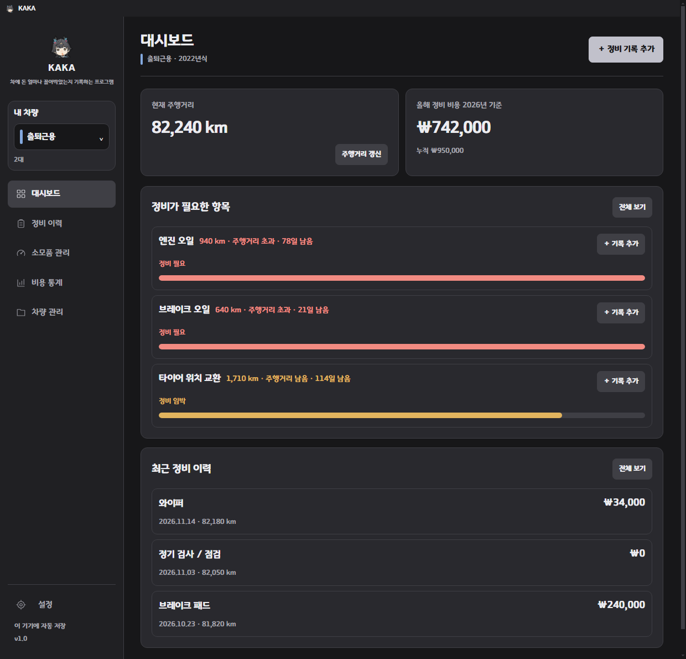

# KAKA v1.0

차에 돈 얼마나 꼴아박았는지 기록하는 프로그램.

KAKA는 Windows 11 x64용 자동차 정비 기록 앱입니다. 차량마다 정비 비용과 주행거리를 기록하고, 다음 소모품 교체 시기를 확인할 수 있습니다.

## 주요 기능

- 차량별 정비 이력과 주행거리 관리, 정비 항목·메모 검색
- 거리와 기간을 기준으로 소모품 교체 시기 표시, 대시보드에서 해당 항목의 기록 바로 추가
- 누적 비용, 월평균 정비 비용, 월별 그래프에서 해당 달의 정비 이력 열기
- 한국어·영어, 그래파이트·화이트 테마, 오프라인 저장과 JSON 백업

## 스크린샷

아래 화면은 예시 데이터로 촬영했습니다.

[월별 비용에서 열리는 정비 이력 화면 보기](docs/screenshots/monthly-history.png)

## Windows 11 설치

1. GitHub 저장소의 **Releases**에서 최신 버전의 `KAKA-Setup-버전.exe`를 받습니다.
2. 기존 KAKA가 열려 있으면 닫고 새 설치 파일을 실행합니다. 기본 설치는 현재 Windows 사용자 계정용입니다.

설치 없이 사용하려면 같은 릴리스의 `KAKA-Portable-버전.exe`를 실행합니다. 두 버전 모두 Electron과 경기천년제목체가 들어 있으며, 기록과 백업은 오프라인에서 사용할 수 있습니다. 저장 위치는 두 버전 모두 `%APPDATA%\KAKA`입니다.

서명 없이 빌드한 실행 파일은 Windows SmartScreen에서 경고를 표시할 수 있습니다. 릴리스에 첨부된 `SHA256SUMS.txt`에서 배포 파일의 SHA-256을 확인할 수 있습니다.

## 소스 실행과 릴리스

- Windows x64에서 Node.js와 npm으로 `START.cmd` 또는 `npm.cmd start`를 실행합니다. Electron의 최초 설치나 복구에는 인터넷이 필요합니다.
- 로컬 빌드는 `npm.cmd ci` 후 `npm.cmd run dist`를 실행합니다. `npm.cmd run dist:dir`는 실행 폴더를 빌드합니다.
- GitHub에 소스를 올린 뒤 패키지 버전과 일치하는 태그(첫 공개 버전은 `v1.0.0`)를 올리면 GitHub Actions가 설치형·포터블 EXE와 해시를 만들고 **Draft Release**에 첨부합니다. 릴리스 화면에서 내용을 확인하고 직접 공개합니다. Actions에서 수동으로 실행하면 빌드 산출물만 생성합니다.

## 데이터 호환

- 데이터 경로는 `%APPDATA%\KAKA`이며 SQLite 파일명 `garage-log.sqlite`, 자동 백업 폴더 `backups`, 기존 앱 ID를 사용합니다.
- 기존 SQLite 스냅샷과 JSON 백업을 읽을 수 있습니다. 기존 기록에서 2000년 이전 날짜를 그대로 두고 편집할 수 있습니다.
- 경기천년제목체 배포 고지는 `src/fonts/NOTICE.txt`에 있습니다.

## 공개 전 개발 기록

개발 기록 보기

### 내부 개발판 v1.3.2

- 월별 비용 줄을 누르면 해당 월의 정비 이력이 열립니다. 검색과 정렬을 함께 사용할 수 있고, 월 필터를 해제하거나 비용 통계로 돌아갈 수 있습니다.
- 대시보드에서 정비가 필요한 항목의 게이지를 보고 바로 기록을 추가할 수 있습니다.
- 열려 있는 화면 위주로 갱신하고, 소모품 교체 주기에 쓰는 정비 이력 정렬과 주행거리 계산을 한 번만 수행합니다.
- 설치형 EXE는 현재 사용자 계정용 설치로 구성했습니다.

### 내부 개발판 v1.3.1

- 달력의 여백을 줄이고 연도와 월의 가운데 정렬을 맞췄습니다. 월과 연도를 변경할 때 키보드 포커스를 유지합니다.
- 정비 항목 검색에 결과 개수를 표시합니다. 결과가 하나일 때 Enter로 선택할 수 있습니다.
- 이전 명칭과 띄어쓰기 변형을 검색에 반영합니다. 저장된 명칭은 그대로 유지합니다.
- 주행거리의 잘못된 쉼표 표기를 표시하고, 앞뒤 정비 기록과 충돌하는 경우 차이를 안내합니다.
- 비용 통계에서 누적 비용을 강조하고 월평균과 월별 정비 비용을 함께 볼 수 있습니다.

### 내부 개발판 v1.3

- 설정 → 화면 및 디자인에서 한국어·영어를 즉시 전환합니다. 사용자 차량명, 메모, 사용자 추가 소모품과 저장 식별자를 유지합니다.
- 달력은 필요한 주만 표시하며 표시 범위는 2000년부터 현재 연도까지 자동 계산합니다.
- 기본 정비 항목은 여섯 분류로 나누고 사용자 소모품은 별도로 표시합니다. 항목 검색은 한국어·영어와 공백 차이를 지원합니다.
- 잘못된 주행거리 입력을 표시합니다. 날짜 순서와 주행거리가 어긋나는 기록은 비교 대상과 함께 안내하고 확인 후 저장할 수 있습니다.
- 차량별 누적 비용, 올해 비용, 선택 연도 합계를 표시합니다. 월평균은 올해의 경우 현재 월을 포함한 경과 월 수로, 과거 연도는 12개월로 나눕니다.
- 그래파이트·화이트 테마와 기존 KAKA 캐릭터, 경기천년제목체를 유지합니다. 화이트 테마에서는 입력창과 상태 색상 대비를 높였습니다.

아래 내용은 v1.2 소스에 포함되어 있던 이력입니다. 위의 실행 안내와 v1.3 변경 사항을 기준으로 사용합니다.

# KAKA v1.2

Windows 11용 정비 기록 프로그램. 기존 localStorage 및 백업 JSON 호환.

## 기존 사용자 업데이트
앱 종료 및 수동 백업 후 기존 폴더에 업데이트 ZIP의 src, electron 폴더를 덮어씁니다. npm 재설치 없이 npm.cmd start.

## 신규 실행
`npm.cmd install` 후 `npm.cmd start`. 설치 파일: `npm.cmd run dist`.

## 기능
차량 대수 제한 제거, 월별 비용, 소모품 교체 주기(정비 기록에서 직접 연결), 자동 백업(시작 및 저장 시 해당 날짜 파일 갱신, 최근 30개 날짜 보관), 수동 JSON 복원.

## 글꼴
경기천년제목체가 Windows에 설치되어 있으면 사용합니다. 글꼴 파일은 포함하지 않습니다. 경기도 공식 페이지에서 설치: https://www.gg.go.kr/contents/contents.do?ciIdx=679&menuId=2457 . 미설치 시 맑은 고딕으로 표시됩니다.

자동 백업 폴더는 데이터 관리에서 열 수 있습니다. 같은 디스크의 백업은 디스크 고장에 대비하지 못하므로 별도 백업 권장. Windows 실행 및 설치 빌드는 미검증.

## v1.3.1
기본 관리 항목 7개(엔진오일 가혹 조건은 주기 편집으로 선택). 실제 정비 기록으로만 계산. 기록 입력 시 자동 추천 및 직접 확인. 기존 관리 항목 유지. 경기천년제목체는 시스템 설치 시 사용하며 내장 파일은 미포함.

## v1.3.2 폰트 준비
Windows에서 setup-fonts.cmd를 한 번 실행하면 경기도청 공식 웹폰트 ZIP을 내려받아 src/fonts에 저장합니다. 이후 오프라인으로 사용 가능하며 빌드에도 포함됩니다. 다운로드 및 파일명 인식은 실제 Windows에서 테스트하지 않았습니다.

## v1.3.3 자동 폰트 준비
`npm.cmd start`는 최초 실행 시 공식 웹폰트를 자동 다운로드합니다. 최초 실행에는 인터넷이 필요합니다. 실패 시 기본 글꼴로 실행하고 다음 시작 시 재시도합니다. `npm.cmd run dist`는 폰트 확보 후 설치 파일에 포함하며, 확보 실패 시 빌드를 중단합니다. 설치 프로그램 사용자는 별도 폰트 설치가 필요 없습니다.

## v1.3.5
- 좌측 사이드바 및 대시보드, 차량 관리·설정 분리
- 주행거리 및 비용 입력 천 단위 콤마
- 기존 localStorage 및 자동 백업 유지

## v1.4.0
업데이트 ZIP의 파일과 폴더를 기존 프로젝트에 덮어씁니다 (package.json 포함). npm 재설치 없이 npm.cmd start. SQLite는 Electron 내장 Node의 node:sqlite가 지원되는 환경에서 사용되며, 미지원 시 기존 localStorage를 사용합니다. 설정에서 저장 상태를 확인하세요. 이전 데이터는 별도 JSON 백업 후 SQLite 단일 스냅샷 테이블에 저장합니다. 기존 Electron 35의 Windows 실행 여부는 미검증입니다.
- 다중 항목 정비 기록과 합계, 현재 주행거리 갱신, 정비소 입력 제거
- 정비 이력 CSV/XLSX (선택 차량 또는 전체 차량, 한 항목당 한 행)
- 설정에서 공개 GitHub 저장소 owner/repo 입력 후 최신 정식 Releases 수동 확인. 자동 설치 없음.
- 정비 이력 제목/가격 23px, 메타 17px, 버튼 14px 유지

## v1.4.1
- 사이드바 및 고정 헤더, 정비 이력 월별 그룹과 방문별 카드, 소모품 반응형 카드, 우측 하단 알림.
- 차량 삭제 대상 별도 선택 및 삭제 직전 별도 JSON 백업. 마지막 차량은 기존처럼 삭제할 수 없습니다.
- 팝업 등장/종료 효과, 메뉴 전환, 메뉴별 스크롤 위치 복원, 모션 감소 설정 지원.
- 기존 데이터 형식과 폰트 로딩, SQLite 지원 여부에 따른 저장 방식 유지.

## v1.4.3
- 정비 이력 접기/펼치기, 소모품 핵심 정보 카드, 입력창 및 설정 화면 정리.

## v1.4.3
ROCACACA로 이름 변경. 기존 앱 ID 및 데이터 파일명 유지. 그래파이트 기본 포함 6개 테마, 차량 선택 두 줄, 차량별 소모품 순서 드래그/Alt+방향키 이동. 사진 아이콘은 개인 테스트용이며 공개 배포 전 권리 확인 필요.

## v1.4.5
- 숫자 입력 증감 컨트롤, 테마별 드롭다운, 차량 요약 카드, 설정 분류, 게이지 및 카드 이동 애니메이션, 툴팁, 스크롤바, 빈 상태 개선.
- 창 크기/위치 및 마지막 메뉴 복원. 기존 선택 차량 저장 및 데이터 경로 유지.
- 업데이트 전 JSON 백업 권장. Windows GUI 테스트 필요.

## v1.4.5
차량별 내보내기, 정비 기록 초기화(삭제 직전 백업), 전기자동차 체크, 미션오일 기본 주기, 다음 정비 한 줄 표시 및 개월수 버튼 재배치. 기존 사용자 수정 항목은 보존합니다. 전기차 냉각수 주기는 미설정이며 취급설명서에 따라 설정하세요.

## v1.4.6
- 사이드바 로고 중앙 정렬.
- 대시보드 주행거리 및 비용 요약, 정비 임박·필요 항목만 표시, 최근 3건.
- 소모품 상태 필터와 개수 표시. 전체 보기에서만 순서 이동 가능; 저장 순서 유지.

## v1.4.7
정비 이력 검색 및 정렬, 소모품에서 기록 추가, 그래파이트·화이트 테마, Windows 제목 표시줄 연동, 타이어 연동, 달력 범위 제한, 정비 기록 연동 접기 및 저장 영역 개선.

## KAKA v1.0 (ROCACACA 이후 새 버전 체계)
표시 버전 v1.0, 패키지 버전 1.0.0. 앱 ID, 저장 파일명 및 기존 저장 키 유지. 직접 추가한 소모품도 정비 항목 선택 및 연동 가능. 기존 ROCACACA 릴리스가 등록된 GitHub 저장소는 KAKA 릴리스로 변경해야 올바른 버전 비교가 가능합니다. 원본 이미지의 공개 배포 권리는 별도 확인하세요.

## KAKA v1.1
- 기존 폴더에 업데이트 ZIP 전체를 덮어쓰기. 기존 node_modules 유지.
- 사용자 데이터는 %APPDATA%\KAKA로 이전합니다. 기존 후보 폴더 여러 개가 발견되면 이전을 중단하며 자동 병합하지 않습니다. 기존 KAKA 폴더는 덮어쓰지 않습니다.
- 최초 실행은 빈 차량 목록, 첫 차량 등록 및 백업 복원. 기존 데이터가 있으면 유지합니다.
- 설정에서 경로, 용량, 마지막 자동 백업, 폴더 열기, 완전 초기화 제공. 초기화 시 백업은 보존합니다.
- 설치 프로그램의 사용자 데이터 삭제 확인은 새로 빌드한 설치 파일에 적용됩니다. 기존 설치 위치는 업그레이드 시 유지될 수 있습니다. 무인 설치 제거에서는 데이터를 보존합니다.
- Windows 및 NSIS 실제 빌드는 미검증.

## KAKA v1.2
- Windows x64 소스 실행: `START.cmd` 또는 `npm.cmd start`. 기존 node_modules 유지.
- Electron 35.7.5 필수 파일과 실행 버전을 검사하며, 필요할 때만 공식 GitHub 릴리스 ZIP 및 SHA256 체크섬을 받아 검증 후 복구합니다. 최초 설치 또는 복구에 인터넷이 필요합니다. Node.js x64는 소스 실행에 필요합니다.
- 차량별 8가지 구분 색상, 정비 대상 차량 표시, 로고 세로 배치, 전기차 안내 및 기록 없음 문구 변경.
- 기존 데이터 폴더 및 내부 앱 식별자 유지. 업데이트 전 백업 권장.

