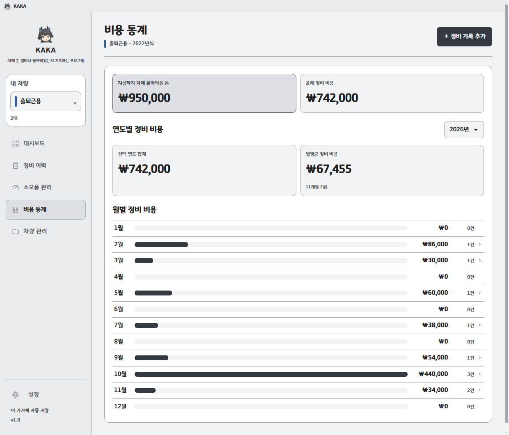

# KAKA v1.0

차에 돈 얼마나 꼴아박았는지 기록하는 프로그램.

KAKA는 Windows 11 x64용 자동차 정비 기록 앱입니다. 차량마다 정비 비용과 주행거리를 기록하고, 다음 소모품 교체 시기를 확인할 수 있습니다.

## 주요 기능

- 차량별 정비 이력과 주행거리 관리, 정비 항목·메모 검색
- 거리와 기간을 기준으로 소모품 교체 시기 표시, 대시보드에서 해당 항목의 기록 바로 추가
- 누적 비용, 월평균 정비 비용, 월별 그래프에서 해당 달의 정비 이력 열기
- 한국어·영어, 그래파이트·화이트 테마, 오프라인 저장과 JSON 백업

## 스크린샷

아래 화면은 예시 데이터로 촬영했습니다.

[월별 비용에서 열리는 정비 이력 화면 보기](docs/screenshots/monthly-history.png)

## Windows 11 설치

1. GitHub 저장소의 **Releases**에서 최신 버전의 `KAKA-Setup-버전.exe`를 받습니다.
2. 기존 KAKA가 열려 있으면 닫고 새 설치 파일을 실행합니다. 기본 설치는 현재 Windows 사용자 계정용입니다.

설치 없이 사용하려면 같은 릴리스의 `KAKA-Portable-버전.exe`를 실행합니다. 두 버전 모두 Electron과 경기천년제목체가 들어 있으며, 기록과 백업은 오프라인에서 사용할 수 있습니다. 저장 위치는 두 버전 모두 `%APPDATA%\KAKA`입니다.

서명 없이 빌드한 실행 파일은 Windows SmartScreen에서 경고를 표시할 수 있습니다. 릴리스에 첨부된 `SHA256SUMS.txt`에서 배포 파일의 SHA-256을 확인할 수 있습니다.

## 소스 실행과 릴리스

- Windows x64에서 Node.js와 npm으로 `START.cmd` 또는 `npm.cmd start`를 실행합니다. Electron의 최초 설치나 복구에는 인터넷이 필요합니다.
- 로컬 빌드는 `npm.cmd ci` 후 `npm.cmd run dist`를 실행합니다. `npm.cmd run dist:dir`는 실행 폴더를 빌드합니다.
- GitHub에 소스를 올린 뒤 패키지 버전과 일치하는 태그(첫 공개 버전은 `v1.0.0`)를 올리면 GitHub Actions가 설치형·포터블 EXE와 해시를 만들고 **Draft Release**에 첨부합니다. 릴리스 화면에서 내용을 확인하고 직접 공개합니다. Actions에서 수동으로 실행하면 빌드 산출물만 생성합니다.

## 데이터 호환

- 데이터 경로는 `%APPDATA%\KAKA`이며 SQLite 파일명 `garage-log.sqlite`, 자동 백업 폴더 `backups`, 기존 앱 ID를 사용합니다.
- 기존 SQLite 스냅샷과 JSON 백업을 읽을 수 있습니다. 기존 기록에서 2000년 이전 날짜를 그대로 두고 편집할 수 있습니다.
- 경기천년제목체 배포 고지는 `src/fonts/NOTICE.txt`에 있습니다.

#

